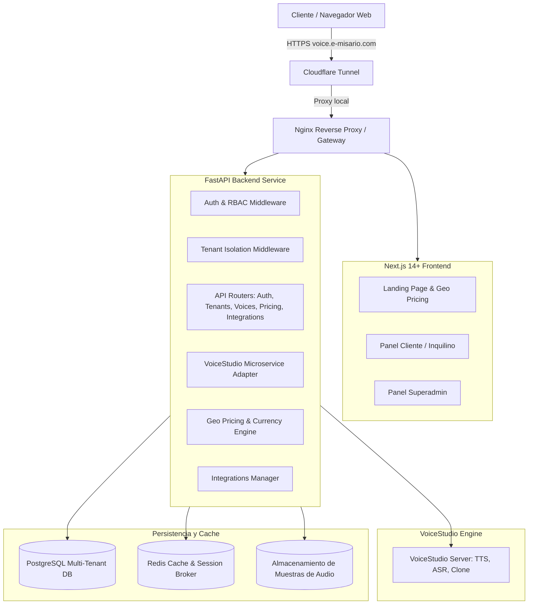

# Arquitectura del Sistema — E-MIS@RIO SAS

## Diagrama de Componentes de Alto Nivel

## Flujo de Resolución de Inquilinos (Multi-Tenancy)
1. **Subdominio:** Un cliente accede por `empresa-a.voice.e-misario.com`. El middleware extrae `empresa-a` y consulta el inquilino activo.
2. **Header:** Solicitudes directas de API pueden enviar `X-Tenant-ID: <uuid_o_slug>`.
3. **Token JWT:** Usuarios autenticados llevan el claim `tenant_id` en su token de sesión.
4. **Aislamiento en Consultas:** Toda operación de lectura/escritura filtra forzosamente por `tenant_id`.

## Modelo de Precios y Geolocalización
- Detección primaria vía Cloudflare Header `CF-IPCountry`.
- Conversión de precios base en USD a monedas locales (COP, MXN, ARS, CAD, EUR, etc.).
- Reglas de redondeo comercial para no mostrar precios con fracciones extrañas.
- Panel Superadmin para ajustar tasas de cambio y márgenes por país.
